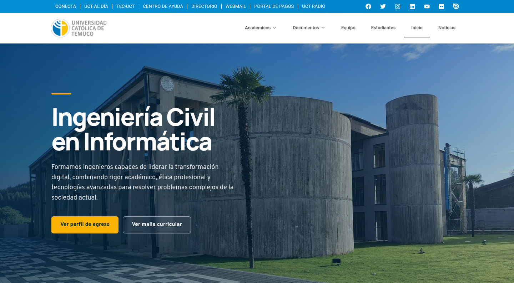

## De un WordPress abandonado a una plataforma institucional

Cuando asumí como webmaster de la carrera, el sitio funcionaba sobre WordPress y Elementor, sin mantenimiento y con contenido difícil de actualizar. La primera etapa usó Astro como frontend desacoplado de ese WordPress para validar el diseño y la estructura; después reemplacé el CMS por Payload.

El objetivo no fue solo rehacer un sitio. Lo diseñé como una plataforma que otras unidades de la universidad puedan reutilizar: Payload describe el contenido institucional (académicos, noticias, programas, planes de estudio, documentos) y Astro decide cómo se presenta. Las páginas se componen con secciones con significado editorial, en lugar de un editor visual sin estructura.

## Decisiones principales

- **Sitio estático:** Astro genera el sitio completo en cada publicación y el navegador nunca consulta el CMS. El sitio público es rápido y no depende de que Payload esté disponible.
- **Permisos por dominio editorial:** cada cuenta mantiene solo lo que le corresponde, como su perfil académico, y las autoridades de la carrera pueden editar el resto. El acceso usa las cuentas Google de la universidad.
- **Publicaciones automáticas:** los perfiles académicos sincronizan sus publicaciones desde OpenAlex y ORCID todos los días.
- **Despliegue sin pasos manuales:** GitHub Actions construye las imágenes, las publica y reinicia las aplicaciones en Kubero, la plataforma de la universidad.

## Resultado

El sitio está publicado en el dominio oficial, inf.uct.cl, y el CMS en cms.inf.uct.cl. Las decisiones de arquitectura quedaron documentadas para que otro responsable pueda continuar el proyecto.
