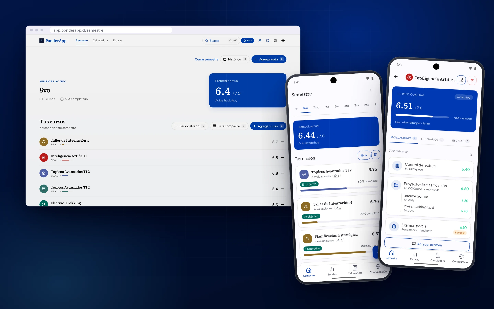
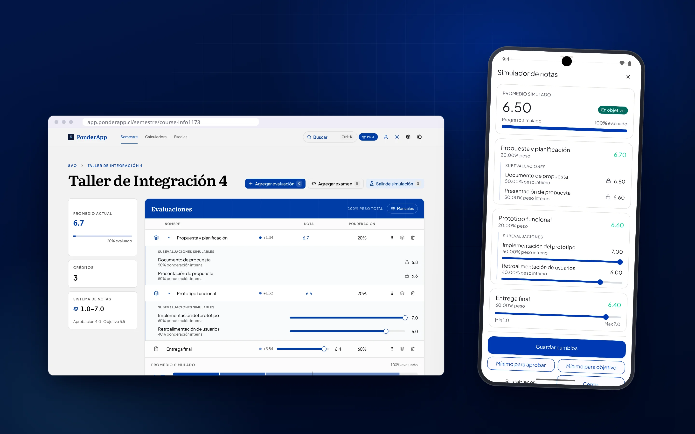
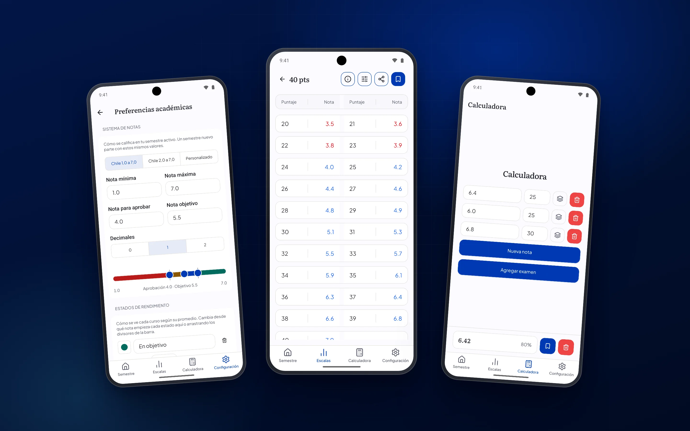

## Cómo voy y qué necesito

PonderApp empezó como una calculadora para mis propias notas, cuando un ramo con evaluaciones compuestas ya no cabía en una planilla. Hoy está publicada en Google Play y en la web, y responde las preguntas que un estudiante se hace durante el semestre: cómo va en cada curso, qué nota necesita en lo que falta y qué pasa si cambia una nota.

Cada semestre reúne cursos con evaluaciones, subevaluaciones y examen. El promedio se actualiza con cada nota, y cada curso muestra su estado según la nota de aprobación, el objetivo y los umbrales que define el estudiante. Los semestres cerrados forman un histórico con el promedio ponderado por créditos, y los widgets de Android muestran la próxima evaluación y el promedio sin abrir la app.

## Simular antes de decidir

El simulador separa cuánto aporta cada evaluación a la nota final y permite mover las notas pendientes para ver el resultado. Calcula el mínimo para aprobar o para llegar al objetivo, y guarda cada combinación como un escenario que se puede retomar.

## Escalas y sistemas de notas propios

Algunos profesores evalúan con puntos, y cada institución usa su propio sistema de notas. PonderApp genera tablas de conversión de puntos a nota con fórmulas incluidas o personalizadas, las reutiliza en los cursos y permite configurar el sistema de notas de cada semestre. Las escalas son gratuitas porque sirven para entender las notas; no las reservo para el plan Pro. Para un cálculo rápido sin crear un curso, hay una calculadora libre.

## Local primero

Registrar, calcular y simular nunca esperan a la red. La fuente de verdad está en el dispositivo: SQLite en Android y almacenamiento local detrás de un repositorio en la web. Convex solo sincroniza y respalda, sin cálculos ni reglas del dominio. Si el backend dejara de existir, la aplicación seguiría funcionando.

Esa decisión ordena el resto:

- **Un solo dominio académico.** Los cálculos, las escalas y las validaciones viven en paquetes compartidos, así que Android y la web dan el mismo resultado.
- **La cuenta no reemplaza los datos.** Iniciar sesión agrega sincronización y respaldo. No crea otro espacio ni borra lo que ya está en el teléfono.
- **Pro sin bloquear lo esencial.** RevenueCat gestiona la suscripción, el acceso se verifica también sin conexión y los datos siguen legibles si la suscripción vence.
- **Actualizaciones sin pasar por la tienda.** Los cambios de JavaScript llegan por OTA. Cada versión se publica primero en Preview, y la secuencia exige que el backend esté actualizado antes de enviarla.

## Cómo lo trabajo

Desarrollo PonderApp solo, desde la definición del producto hasta la publicación. Antes del lanzamiento la probé con compañeros para encontrar fricciones al ingresar y consultar notas. Las decisiones de arquitectura quedan en más de treinta ADR, un registro de features indica en qué plataforma está cada capacidad, y las capturas de la tienda y de esta página salen de la aplicación real con datos de ejemplo reproducibles.
